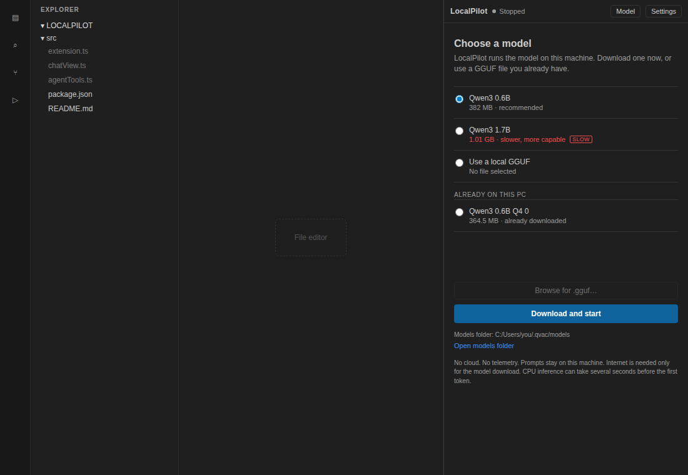
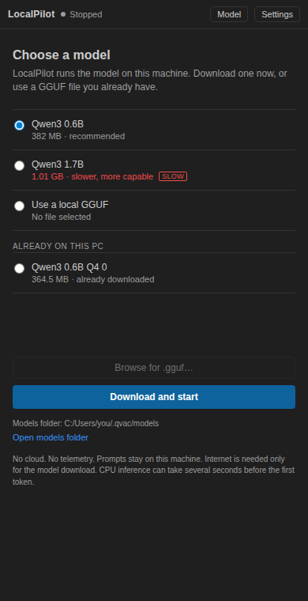
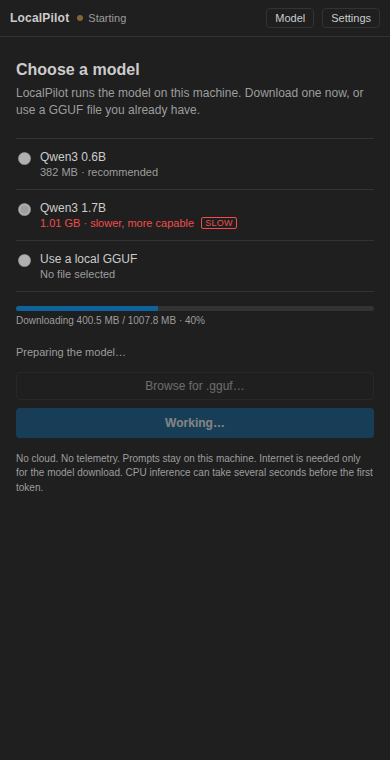
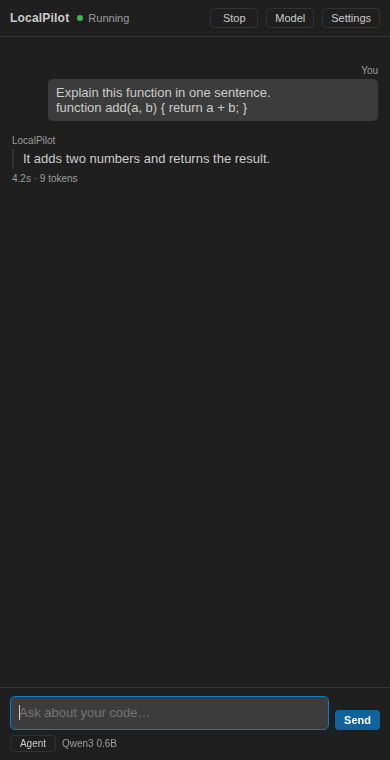
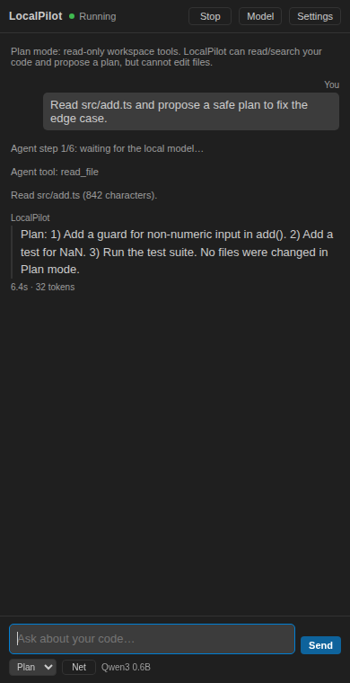
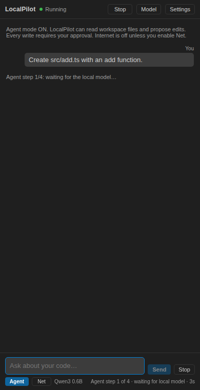
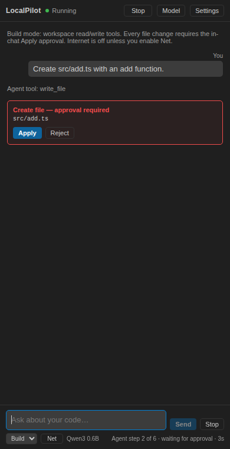
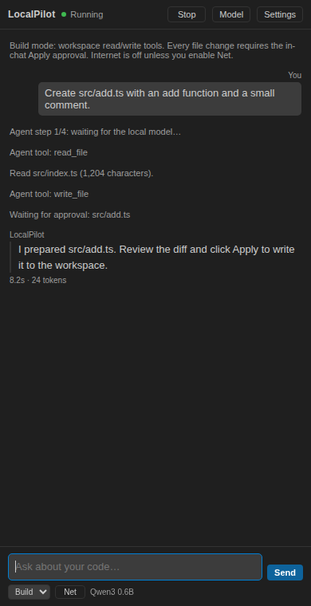
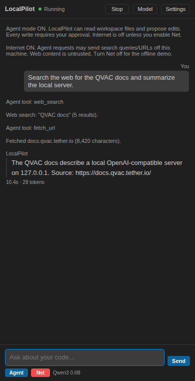

# LocalPilot

LocalPilot is a Windows-first VS Code extension for private, CPU-first local AI coding help using [QVAC](https://qvac.tether.io). It starts a QVAC runtime, preloads one local model, provides a chat view in the VS Code Secondary Side Bar, and explains only the code you explicitly select.

No cloud inference. No telemetry. No prompt or source-code logging. Chat is read-only and streams tokens with the active editor context. Plan/Build casual questions also stream; only explicit file actions enter the tool loop. Build mode can edit workspace files only after you review a diff and click **Apply**. The runtime is bound to loopback.

Source and releases: **https://github.com/bolajiev/localpilot**

## Verification status

The complete extension was built, packaged, and exercised against a **real QVAC model** in this repository's development environment:

- Real QVAC CLI `0.16.0` with bundled SDK `0.22.0`, Node.js `24.21.0`, VS Code `1.143.1` test host, Linux x64, CPU backend (no Vulkan ICD).
- Secondary Side Bar, managed start, runtime check, streaming chat, Explain Selected Code, managed stop, and loading an existing local GGUF passed in a VS Code Extension Host integration test.
- The private QVAC installer was verified with a real 3.3 GB install and managed-runtime resolution; its interactive confirmation prompt is not automated.
- The Windows `win32-x64` VSIX was built with Node.js 24.21.0, npm, and a trimmed chat-only QVAC runtime bundled. The model is not bundled; the welcome/setup flow downloads it or loads a local GGUF. Windows execution itself is still NOT TESTED.
- Chat and code explanation passed again with external networking disabled in an isolated Linux network namespace.
- **Windows-specific execution and the Windows Vulkan 1.4 gate were not tested here.** The repository was developed in a Linux environment, not on the target Windows PC. Run the verification steps below on the target machine before claiming Windows support.

Measured results and the full acceptance matrix are in [`IMPLEMENTATION_LOG.md`](IMPLEMENTATION_LOG.md).

## UI and placement

LocalPilot contributes its container to VS Code's **Secondary Side Bar on the right**. File Explorer stays in the Primary Side Bar on the left, so you can keep files visible while chatting. This requires VS Code **1.108 or newer**.

The extension does not float over the editor or take an editor tab. If the Secondary Side Bar is hidden, run **LocalPilot: Chat with Local Model** or use **View: Toggle Secondary Side Bar**.



The view is intentionally compact:

- **Header:** status and actions (**Start/Stop**, **Model**, **Settings**).
- **Middle:** the welcome/setup page, then the chat transcript after setup. User messages align right and assistant messages align left, like a normal chat.
- **Bottom:** the message composer, fixed above the status line.
- **Download progress:** a reserved progress area shows downloaded size / total size and percent while a catalog model is being fetched. Larger models carry a red **SLOW** warning.







If the view is not visible, run **LocalPilot: Chat with Local Model**; it focuses the Secondary Side Bar. Reload VS Code after installing.

### Chat / Plan / Build modes

The chat footer has an explicit mode selector:

- **Chat** — no file tools; plain local chat.
- **Plan** — read-only workspace tools; reads and searches your code, then proposes a plan. It cannot write.
- **Build** — read/write workspace tools; every file change needs approval.

Plan and Build automatically include the active editor file or selection (up to 6,000 characters) as local context, so the model can see the code you are looking at. They also have explicit system prompts describing their capabilities and limits.

Build mode has these workspace tools:

- `list_files`
- `read_file`
- `search_text`
- `write_file`
- `replace_in_file`

The model can create or edit files only after it opens a diff and you click **Apply**. It cannot access paths outside the first workspace folder or run shell commands.

If you ask for a file change, LocalPilot forces the write/replace tool if the first inspection step only read files, so the model cannot simply answer with code in chat. The footer shows the current step and elapsed time; write steps add **Waiting for approval: path**.

An approval card appears **inside the chat** with **Apply/Reject**, and the diff opens for review. The agent waits until you decide. Up to six steps are allowed.









### Optional internet tools

In Plan or Build mode, click **Net** to enable two additional tools:

- `web_search` (DuckDuckGo)
- `fetch_url` (public http/https pages only)

**Net is off by default.** When it is off, web tools are not sent to the model at all, so the normal Agent and Chat workflows remain fully local/offline. When Net is on, the query or URL leaves this machine; private/local/loopback addresses and credentials are blocked, and fetched content is truncated and treated as untrusted.



For the hackathon offline demo, leave **Net** off. That proves the core still works locally; the internet feature is explicitly excluded from the offline demonstration.

Tool calling is enabled in the generated QVAC model config. The 0.6B model is small and tool use on CPU can be slow; Plan/Build are experimental. Chat remains the default mode.

## Features and commands

| Command | Behavior |
| --- | --- |
| `LocalPilot: Set Up / Choose Model` | Opens the welcome/setup page in the sidebar. Choose a catalog model to download or select a local `.gguf` file, then continue. |
| `LocalPilot: Check Runtime` | Locates the QVAC CLI and Node.js, runs `qvac doctor`, checks the loopback server/model alias, and reports the Qwen GGUF cache. |
| `LocalPilot: Start / Load Local Model` | Writes a loopback-only QVAC config, starts `qvac serve --openai --no-default`, waits for the model to preload, and reports errors. The first catalog-model run downloads the model. If QVAC is missing, this offers the automatic install. |
| `LocalPilot: Choose Model or Local GGUF` | Opens the same setup page (Qwen3 0.6B, Qwen3 1.7B, or an existing local `.gguf`). |
| `LocalPilot: Chat with Local Model` | Focuses the LocalPilot Secondary Side Bar on the right and its streaming chat. Prompts and responses stay in memory and on this machine. |
| `LocalPilot: Explain Selected Code` | Sends only the current editor selection. With no selection it shows an actionable warning and sends nothing. Oversized selections are rejected. |
| `LocalPilot: Stop Runtime` | Unloads the model and stops the process tree **only if LocalPilot started it**. An external QVAC server is never killed; only its model may be unloaded after confirmation. |
| `LocalPilot: Show Diagnostics Log` | Shows status metadata and sanitized QVAC runtime lines. Prompt/code fields are filtered out. |

After installation, LocalPilot appears in the **Secondary Side Bar (right)**. File Explorer remains on the left. The status-bar item also opens all actions. The editor context menu includes **Explain Selected Code** when text is selected.

## Requirements

### Target machine

- Windows 10/11 x64.
- **Vulkan 1.4 or newer**, including CPU-only inference. Update the AMD/Intel/NVIDIA GPU driver. Verify with the Vulkan SDK's `vulkaninfo --summary`. A machine with no Vulkan 1.4-capable driver does not satisfy QVAC's published Windows requirement.
- **Windows all-in-one VSIX:** includes Node.js `24.21.0`, npm, and a **chat-only QVAC 0.16.0 runtime** (QVAC LLM plugin). The model is **not** preloaded; the welcome page lets the user download one or load their own.
- Generic/source builds require Node.js `22.21+` (22.x) or `24.9+` and also download/set up QVAC.
- VS Code `1.108+` for Secondary Side Bar view containers.
- 16 GB RAM recommended. The default model file is 382 MB, but the QVAC worker used about **1.5 GB RSS** during inference; Windows, VS Code, and the KV cache need memory too.
- About 1.2 GB free disk for the Windows package (about 257 MB download, ~740 MB installed) plus the chosen model (382 MB for the default).
- **Vulkan 1.4+ from the GPU driver** is the only remaining system prerequisite. The extension cannot install graphics drivers.

### Verified development environment

Ubuntu 24.04.5 x64, 6 vCPU AMD EPYC, 11.68 GB RAM, no Vulkan ICD (Linux CPU fallback), Node.js 24.21.0, npm 11.19.0, QVAC CLI 0.16.0, VS Code 1.143.1.

## Windows setup

### 1. Node.js

For the **Windows all-in-one VSIX**, do nothing: Node.js `24.21.0` and npm are bundled.

If you build from source or use the generic/Linux VSIX, install Node.js 22.21+ (22.x) or 24.9+ and verify:

```powershell
node --version
npm --version
```

QVAC CLI does **not** need a manual global install in either case. The Windows build includes it; generic builds install it privately under VS Code global storage when setup starts.

### 2. Verify Vulkan

Install the [LunarG Vulkan SDK](https://vulkan.lunarg.com) or use an existing Vulkan-capable GPU driver, then:

```powershell
vulkaninfo --summary
```

Require a Vulkan API version of 1.4 or newer. If only an older version is available, update the vendor graphics driver first.

### 3. Install the extension

**Download the prebuilt VSIX (recommended):**

Download the latest Windows all-in-one `localpilot-0.12.0-win32-x64.vsix` from:

```text
https://github.com/bolajiev/localpilot/releases/latest
```

Then install it:

```powershell
code --install-extension .\localpilot-0.12.0-win32-x64.vsix
```

Or in VS Code: **Extensions** → `...` → **Install from VSIX**.

The `win32-x64` asset is the recommended Windows package: it contains Node and QVAC. The generic `localpilot-0.12.0.vsix` is for development/other platforms and requires a system Node.js.

**Build from source instead:**

```powershell
npm ci
npm run check
npm run package
code --install-extension .\localpilot-0.12.0.vsix
```

For development, open the folder in VS Code and press **F5** to launch the Extension Development Host. The `preLaunchTask` compiles TypeScript.

### 4. First run

Open LocalPilot in the Secondary Side Bar, or run **LocalPilot: Chat with Local Model**. On first open, the welcome page appears automatically. You can also run **LocalPilot: Set Up / Choose Model**.

1. The sidebar opens on a minimal welcome page. Choose **Qwen3 0.6B** (382 MB download), **Qwen3 1.7B** (1.01 GB), or **Use a local GGUF**.
2. Click **Download and start** or **Use this model**. LocalPilot writes a loopback-only config, starts the included QVAC runtime, and downloads/loads only the model you picked.
3. The page switches to chat when the model is ready. Ask a question, or select code and run **LocalPilot: Explain Selected Code**.
4. Use **Model** in the sidebar header to switch models later.
5. Run **LocalPilot: Stop Runtime** to unload the model and stop the managed process.

The initial response can be slow on CPU: QVAC must load the GGUF, prefill the prompt, and generate the first token. The chat shows a live **waiting for first token** timer while this happens; **Stop** cancels. The default output cap is **256 tokens** to keep replies shorter. Qwen3 1.7B is slower than 0.6B.

### What is inside the Windows VSIX?

The `win32-x64` VSIX contains:

- Node.js `24.21.0` and npm 11.19.0.
- A **trimmed QVAC 0.16.0 chat runtime** with the QVAC LLM plugin, Vulkan/CPU backends, and Windows x64 native components.
- The LocalPilot sidebar and setup flow.

**The model is deliberately not bundled.** The welcome page lets each user download Qwen3-0.6B/1.7B or load an existing GGUF. This keeps the package smaller and avoids forcing one model or license on the user. The model is downloaded once and then cached for offline use.

The QVAC distribution is trimmed to the chat/LLM components and the Vulkan/CPU backends that LocalPilot uses. The full QVAC install is about 2.5 GB on Windows; the trimmed runtime is about 631 MB installed. The Windows VSIX is about **257 MB compressed**, down from the previous 1 GB build.

The only remaining system prerequisite is a **Vulkan 1.4-capable GPU driver**, which an extension cannot safely install.

The generic VSIX remains small and requires a system Node; it also sets up QVAC on first run.

## Offline use

LocalPilot can work offline after one successful online start, because QVAC caches the model under:

```text
%USERPROFILE%\.qvac\models
```

Use this procedure for a real offline check:

1. Connect to the internet and complete **Start / Load Local Model** plus one successful chat.
2. Confirm the response is new local inference, not a cached UI message.
3. Run **Stop Runtime**. Close the Extension Development Host (and VS Code, if using the installed extension).
4. Disable Wi-Fi and Ethernet.
5. Reopen VS Code / the Extension Development Host and run **Start / Load Local Model** again.
6. Run a chat prompt and **Explain Selected Code**. Check that both return new text.
7. Record the result. If the model or runtime tries to download anything, the offline test has not passed.

The repository includes `scripts/offline-test.sh` for Linux CI. It starts QVAC inside an isolated network namespace with only loopback, verifies external HTTPS/DNS are unavailable, loads the cached model, and runs real chat and explanation requests. It passed on the development host. Windows offline validation still needs to be performed manually on the target PC.

## Privacy and local-only behavior

- LocalPilot only constructs `http://` endpoints for `127.0.0.1`, `localhost`, or `::1`. Non-loopback hosts are rejected in settings and in the HTTP client.
- The managed server binds with `--host 127.0.0.1`. It is started with `--openai --no-default`, exposing the OpenAI-compatible text API rather than the full QVAC surface.
- No cloud API, fallback, telemetry, analytics, prompt upload, or external logging exists.
- LocalPilot never logs prompt text, selected code, or model output. The diagnostics channel logs status metadata and sanitized QVAC lines; lines containing content/message/prompt/code/input fields are dropped.
- Model output is displayed as text only. LocalPilot does not write it to files or execute it.
- Chat prompts and selections stay in extension memory. QVAC itself writes model files to `~/.qvac/models` and KV-cache data to `~/.qvac/kv-cache`.
- Agent tools read only the workspace folder. Proposed diffs are written to a temporary folder for review; file writes happen only after **Apply**.
- The optional web tools run only after the user enables **Net**. They have no cloud inference; they fetch public web content and are not used by default.
- The loopback server has no API key by default. Other processes running as your user could call it. Stop the runtime when not needed.

## Model choices and loading a model you already have

Users without a model do **not** need a separate store. On first open, the sidebar shows a minimal welcome page with:

| Choice | Download | Notes |
| --- | --- | --- |
| Qwen3 0.6B Q4 | ≈ 382 MB | Recommended, fastest on CPU |
| Qwen3 1.7B Q4 | ≈ 1.01 GB | Stronger, slower, more RAM |
| Existing local `.gguf` | None | Uses a model already on disk |

After choosing, press **Download and start** or **Use this model**. The page switches to chat when the model is ready. **Model** in the sidebar header reopens the page later. Advanced users can enter another QVAC catalog constant in `localpilot.modelId`.

**If the model is already in QVAC's cache**, the welcome page detects `.gguf` files under:

```text
%USERPROFILE%\.qvac\models        (Windows)
~/.qvac/models                      (Linux/macOS)
```

and lists them under **Already on this PC**. Select one and continue; no download is repeated. The setup page also shows the exact folder and an **Open models folder** link.

**If you have your own GGUF file**, choose **Use an existing local GGUF file…** and select it. LocalPilot writes an explicit QVAC entry:

```json
{
  "src": "C:\\models\\my-model.gguf",
  "type": "llamacpp-completion",
  "preload": true,
  "config": { "ctx_size": 4096 }
}
```

Requirements and caveats for local GGUF files:

- Must be a llama.cpp-compatible chat GGUF with a usable chat template. A file that works in another runtime may still fail or produce poor chat output here.
- The path must be absolute and readable by the same Windows user running VS Code.
- QVAC does **not** verify a local file against catalog checksums. You are responsible for the file's source, integrity, license, and memory fit.
- A 4-bit file size is not peak RAM. The tested 0.6B file used about 1.5 GB RSS in the QVAC worker.
- You can also set `localpilot.modelPath` manually. Clear it (or run **Reset to the default Qwen3 0.6B model**) to return to catalog downloads.

The model list is curated, not a live remote marketplace. A full live catalog browser can use QVAC's `/v1/models/catalog` endpoint later, but that endpoint requires a running server and adds complexity beyond this MVP.

## Model cache and upgrades

LocalPilot **never deletes files in `%USERPROFILE%\.qvac\models`**. Unloading a model releases memory only; it does not remove the GGUF. The welcome page lists cached models under **Already on this PC**, shows the folder, and has **Recover old models**.

The 0.5 Windows VSIX bundled a Qwen model inside the extension folder. Installing 0.6+ replaced that folder, so the bundled copy disappeared; downloaded models in the QVAC cache were not affected. Run **LocalPilot: Recover Old Bundled Models** to copy any model still present in an older LocalPilot extension folder into the QVAC cache. If the old extension folder is gone, re-download the model.

## Default model

| Field | Value |
| --- | --- |
| QVAC catalog constant | `QWEN3_600M_INST_Q4` |
| Upstream source | [`unsloth/Qwen3-0.6B-GGUF`](https://huggingface.co/unsloth/Qwen3-0.6B-GGUF), commit `50968a4468ef4233ed78cd7c3de230dd1d61a56b`, file `Qwen3-0.6B-Q4_0.gguf` |
| License | Apache-2.0 |
| Size | 382,156,480 bytes (about 364 MiB) |
| Parameters / quantization | 0.6B / Q4_0 |
| Default context | 4096 tokens |
| Reasoning | Disabled by default (`reasoning_budget: false`) for CPU latency |
| API alias | `localpilot-model` |

The 0.6B model is intentionally small for CPU-first execution. It is useful for grounded explanations and short answers, but it is not a frontier coding model. On the tested shared 6-vCPU host, throughput was about **0.08-0.1 tokens/second**; do not treat that as a Windows performance prediction.

## Settings

| Setting | Default | Purpose |
| --- | --- | --- |
| `localpilot.qvacPath` | empty | Optional path to `qvac.cmd`, the QVAC executable, or `dist/index.js`. Empty resolves `qvac` from PATH. |
| `localpilot.nodePath` | empty | Optional Node.js 22.21+/24.9+ executable. Empty uses the bundled Node in the Windows all-in-one VSIX, then PATH. |
| `localpilot.host` | `127.0.0.1` | Loopback host only. |
| `localpilot.port` | `11434` | Local QVAC port. Restart the runtime after changing it. |
| `localpilot.modelId` | `QWEN3_600M_INST_Q4` | QVAC catalog constant used when `modelPath` is empty. |
| `localpilot.modelPath` | empty | Absolute path to an existing llama.cpp-compatible `.gguf` file. Takes precedence over `modelId`. |
| `localpilot.modelAlias` | `localpilot-model` | Alias used in OpenAI-compatible requests. |
| `localpilot.contextSize` | `4096` | Model context window (input plus output). |
| `localpilot.maxOutputTokens` | `256` | Maximum generated tokens per response. |
| `localpilot.temperature` | `0.2` | Sampling temperature. |
| `localpilot.enableReasoning` | `false` | Hybrid-model reasoning. Much slower on CPU. |
| `localpilot.maxSelectionChars` | `6000` | Hard limit for Explain Selected Code. Oversized selections are rejected. |
| `localpilot.startupTimeoutMs` | `1800000` | Allows 30 minutes for first download/load. |
| `localpilot.requestTimeoutMs` | `900000` | Per-response timeout. |
| `localpilot.autoStart` | `false` | If false, Chat/Explain asks before starting the runtime. |
| `localpilot.autoInstallQvac` | `true` | Generic builds only: if QVAC is missing, offer to install it privately into VS Code storage. The Windows all-in-one VSIX includes QVAC. |
| `localpilot.stopOnExit` | `true` | Stop a LocalPilot-managed process when VS Code shuts down. External servers are never killed. |

## How it works

```text
VS Code webview / commands
        |
        v
src/extension.ts  ---- conversation, selection guard, prompts
        |
        v
src/runtimeManager.ts ---- spawn, readiness, process ownership, stop
        |          \
        |           `-- src/runtimeLocator.ts  (qvac.cmd/node resolution)
        v
src/qvacClient.ts ---- loopback HTTP + SSE parsing
        |
        v
qvac serve --openai --no-default -c <globalStorage>/qvac.config.json
        |
        v
Qwen3-0.6B GGUF (QVAC cache)
```

- The extension writes its own `qvac.config.json` under VS Code global storage. It does not modify a workspace config.
- `preload: true` means QVAC's port stays closed until the model is loaded, which gives a reliable readiness signal.
- On Windows, LocalPilot resolves the npm `.cmd` shim to the CLI's JavaScript entry point and runs it with `node.exe`. It avoids shell-string command construction. `.cmd` shims are not spawned directly.
- On POSIX, the QVAC process is started in its own process group; shutdown sends `SIGTERM`/`SIGKILL` to the group. On Windows, `taskkill /PID <pid> /T /F` is used for the process tree owned by LocalPilot.
- An already-running QVAC server is reused only if it exposes the configured alias. It is marked **external** and is never killed by LocalPilot.

## Development and tests

```powershell
npm ci
npm run typecheck
npm test
npm run check
```

`npm test` runs 54 unit tests covering SSE parsing, catalog/local config generation, prompt/selection limits, error mapping, sanitizer behavior, runtime locator helpers, and the QVAC HTTP client (including timeout and 404/502 paths).

Linux extension-host integration test (downloads a VS Code test build on first run):

```bash
xvfb-run -a npm run test:integration
```

It verifies command registration, missing-CLI and port-conflict errors, managed start, `qvac doctor`, `/v1/models`, real streaming inference, the panel send path, empty-selection behavior, the actual **Explain Selected Code** command, managed stop, and restarting with a user-supplied local GGUF file.

Real-runtime smoke scripts:

```bash
npm run compile
node scripts/chat-smoke.js "Reply with exactly: LocalPilot online"
node scripts/explain-smoke.js
bash scripts/offline-test.sh
```

Use `LOCALPILOT_MAX_TOKENS` / `LOCALPILOT_TIMEOUT_MS` to keep CI CPU runs short.

Packaging:

```powershell
npm run package
```

## Troubleshooting

See [`docs/TROUBLESHOOTING.md`](docs/TROUBLESHOOTING.md) for detailed Windows guidance. Quick answers:

| Symptom | Action |
| --- | --- |
| QVAC CLI was not found | Windows all-in-one includes QVAC. For generic builds, use **Set Up / Choose Model** or manually install `npm install -g @qvac/cli@0.16.0` and reopen VS Code. |
| Unsupported Node.js | The Windows all-in-one VSIX bundles Node 24.21.0. For generic/source builds, install Node 22.21+ or 24.9+, or set `localpilot.nodePath`. |
| Vulkan/runtime failure | Update the GPU driver; `vulkaninfo --summary` must report Vulkan 1.4+. Required even for CPU. |
| Port already in use | Stop the other service or change `localpilot.port`. LocalPilot will not kill an unknown server. |
| First setup fails while offline | On generic builds QVAC must be installed and the chosen model must be cached. Connect once, complete setup, then retest offline. The Windows all-in-one already includes QVAC. |
| Automatic QVAC install fails | Check internet, free disk (about 4 GB+), and Node/npm. The diagnostics log has the npm error tail. Manual fallback: `npm install -g @qvac/cli@0.16.0`. |
| `model_not_found` | Start the runtime from LocalPilot, or add `localpilot-model` to the external server's `qvac.config`. |
| Local GGUF not found / invalid | Pick the file again with **Choose Model or Local GGUF**; it must be an absolute path to a non-empty `.gguf` file. |
| Local GGUF loads but chat is poor/fails | It may be incompatible with QVAC's llama.cpp chat template or too large; use the tested Qwen3 0.6B default to isolate the issue. |
| Checksum failure | Remove the incomplete model from `~/.qvac/models`, reconnect, and start again. |
| Model fit / out of memory | Close other apps, lower `localpilot.contextSize`, or use a smaller model. |
| Response timeout | Raise `localpilot.requestTimeoutMs`, shorten the prompt, or disable reasoning. |
| External server left running | Run **Stop Runtime** unloads the model only. Stop the external process yourself; LocalPilot does not own it. |
| Need to kill an orphan Windows QVAC process | Find the PID in Task Manager, then `taskkill /PID <pid> /T /F`. |

## Hackathon notes

The official AI Yako rules were checked on 2026-10-26. The event requires a repository link, a demo video, and meaningful QVAC use with the core AI feature working with the internet off. Remote participation is allowed. See [`docs/DEMO.md`](docs/DEMO.md) and [`docs/HACKATHON.md`](docs/HACKATHON.md).

Recommended track: **Offline AI apps**.

## Known limitations

- Windows execution is unverified in this repository. The Vulkan 1.4 gate is the highest-risk Windows blocker.
- CPU latency is high in the shared CI environment; measure the target PC.
- One active model and alias. There is no multi-model routing, RAG, or embeddings.
- Plan/Build modes are bounded to workspace file tools plus optional Net web search/fetch. They have no shell/command execution and no autonomous writes; every file change needs diff approval. They use the first workspace folder in multi-root workspaces.
- The 0.6B model's tool-call reliability varies; Plan/Build are experimental.
- Internet tools are optional and off by default. When enabled, Agent web search/fetch sends queries/URLs to external services; this is excluded from the offline demo.
- The Windows VSIX bundles a chat-only subset of QVAC to keep the download small (about 257 MB). Image/speech/translation QVAC addons are not included; install full QVAC separately if you need those (LocalPilot only uses chat).
- The model is not bundled; the welcome page downloads/loads the user's choice.
- Vulkan 1.4 remains a system driver prerequisite; the extension cannot install GPU drivers.
- The automatic QVAC installer remains the fallback for generic builds. It was tested with a real 3.3 GB npm install; its interactive modal prompt is not automated.
- The Windows all-in-one VSIX could not be executed on Windows in this environment. Package contents and bundled-runtime selection were verified on Linux; Windows runtime validation remains pending.
- The welcome page offers a curated shortlist (Qwen3 0.6B/1.7B or a local GGUF), not a live model marketplace. Local GGUF loading bypasses QVAC checksum validation.
- Reasoning is disabled by default; enabling it can consume the entire output budget.
- The chat send path and Explain command are automated through the VS Code extension host; the raw webview button-click event itself is not simulated.
- QVAC 0.16.0 is pinned/tested. Newer CLI releases may change flags or behavior.
- The QVAC server is unauthenticated on loopback by default, like most local model servers.
- Model and KV caches can consume disk; QVAC stores them under `~/.qvac`.

## License

LocalPilot source code: MIT. Qwen3-0.6B model: Apache-2.0.
